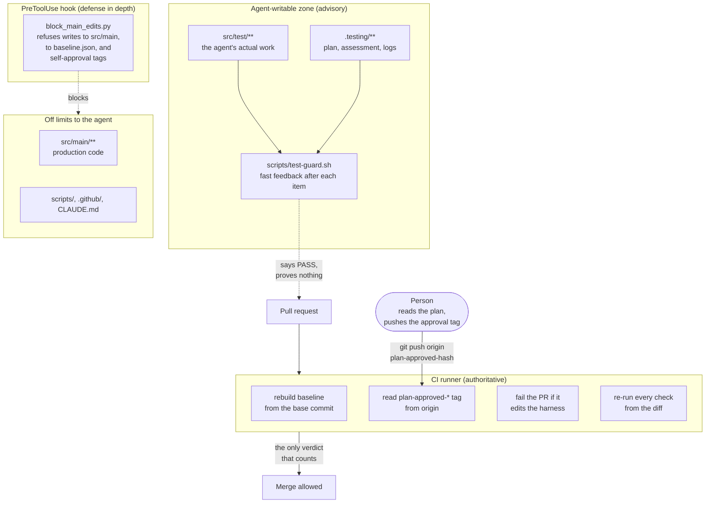
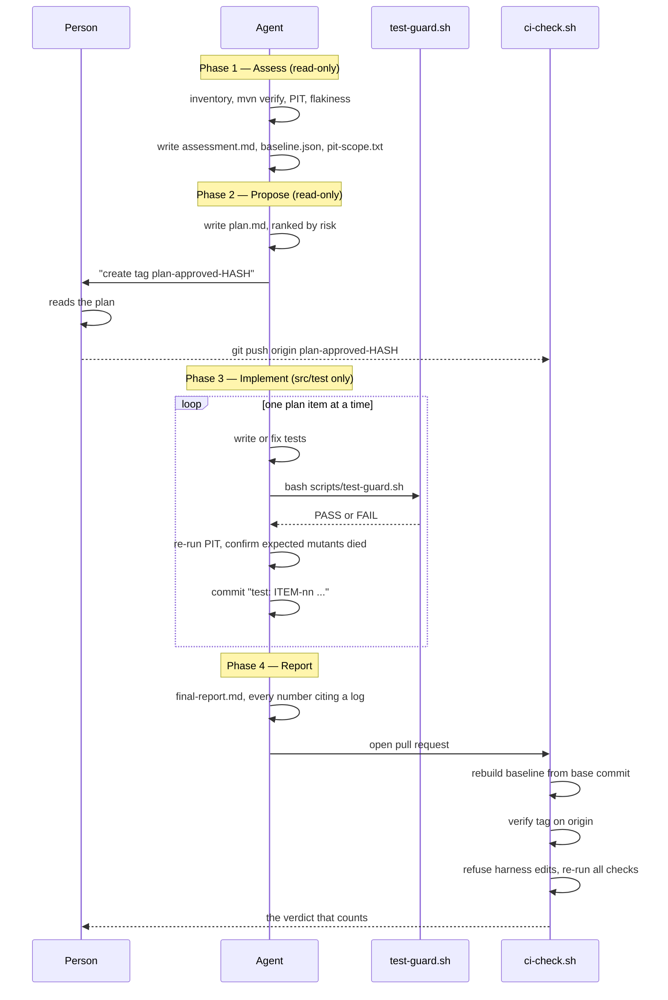

# Architecture

## The problem

A service has 80%+ line coverage and still needs a manual regression pass before
every release. Coverage counts lines executed, not behaviour verified: a test can
run a method, assert nothing, and still score. So nobody trusts the suite, and a
person re-checks the same flows by hand each time.

An AI agent can write the missing tests quickly. That creates a second problem:
how do you know the tests it wrote actually check anything, and that it did not
quietly change production code or move the goalposts to make its own work pass?

This repository is the answer to the second problem. It is not a test runner.

## The core idea: two levels of enforcement

The first version of this harness put every check inside the tree the agent was
allowed to write. Attacking it found six holes — the full list is in the README.
The lesson generalises:

> A check that runs on files the agent can edit is a checklist, not a guardrail.

So enforcement is split, and only one level counts.

| | `scripts/test-guard.sh` | `scripts/ci-check.sh` |
|---|---|---|
| Runs | in the agent's working tree | on a CI runner |
| Mutation baseline | reads `.testing/baseline.json` | **rebuilds it from the base commit** |
| Plan approval | local tags | **tags fetched from the remote** |
| Harness edits | not checked | **fails the PR** |
| Status | fast feedback | **authoritative** |

The agent cannot push, so it cannot create the remote tag. It cannot run the CI
job, so it cannot alter the recomputed baseline. Everything it *can* reach is
advisory by design.

## Components

| Path | Responsibility |
|---|---|
| `scripts/test-guard.sh` | Local checks after each plan item. Composes the four scripts below. |
| `scripts/ci-check.sh` | Authoritative. Recomputes the baseline in a clean worktree, verifies the remote tag, then runs the guard with the recomputed value. |
| `scripts/pit_score.py` | Parses PIT XML with a real parser. Refuses a report that predates the last `src/` commit, or whose class scope differs from the baseline. |
| `scripts/test_census.py` | The ratchet. Counts test methods and assertions at two refs; fails on a decrease. |
| `scripts/approval.py` | Approval as a git tag named for a hash of the plan's content. |
| `scripts/hooks/block_main_edits.py` | PreToolUse hook. Inspects Edit/Write/MultiEdit **and Bash** commands. |
| `.claude/agents/*.md` | The assessor, implementer and reporter subagents. |
| `.claude/skills/test-hardening/SKILL.md` | Ties the phases together for the agent. |
| `.github/workflows/test-hardening.yml` | Wires `ci-check.sh` to pull requests. |
| `CLAUDE.md` | Rules the agent reads each session. Not a control; the scripts are. |

## The four checks, and what each one actually catches

### 1. Production code untouched
`git diff --name-only BASE...HEAD | grep '^src/main/'`

Catches the obvious case. The hook tries to prevent it earlier, but the diff is
what proves it, because the hook can be worked around and the diff cannot.

### 2. The ratchet
Test methods and assertions, counted at two refs, may not fall.

A blocklist of forbidden strings cannot cover an open-ended problem — there are
unlimited ways to weaken a test. A monotonic invariant can. It catches deleting a
test outright and gutting one until it asserts nothing, neither of which any
pattern match would have flagged.

It runs against **both** the branch base and the previous commit. Base alone is
not enough: on a multi-item branch, deleting a test still leaves the total above
the base, so the drop passes unnoticed. That was a real hole, found by attacking
the fixed version.

A correct removal is still possible — put `Ratchet-Decrease: <reason>` in the
commit message. It stays visible in history, which is the point.

### 3. Plan approval
The tag is named `plan-approved-<first 12 hex of sha256(plan.md)>`.

Because the name is bound to the plan's content, editing the plan invalidates an
existing tag. An agent writing `Status: APPROVED` into the file changes the hash
and locks itself out. The person reads the plan, then creates and pushes the tag.
CI reads it from the remote, where the agent has no push.

### 4. Mutation score
PIT changes the code in small ways and checks whether a test fails. A surviving
mutant is a behaviour no test is watching.

Three ways this check used to lie, all now closed:
- **Stale report.** A leftover report from an earlier run scored as current.
  Now the report must be newer than the last commit touching `src/`. Anchoring to
  `HEAD` instead was wrong — a docs-only commit made a valid report look stale,
  which trains people to ignore the check.
- **Scope swap.** A score on one class compared against a baseline from another.
  Now the mutated-class set is recorded and must match.
- **Parsing.** A grep for `status='KILLED'` read double-quoted or single-line
  reports as zero. Now it is parsed as XML.

## Phase flow

## Trust model, stated plainly

**Holds:** CI recomputing from the diff. The agent cannot run the job, edit the
scripts on the runner, or push the tag.

**Helps, does not hold:** the PreToolUse hook. It matches shell patterns, and
shell quoting is open-ended — base64, a variable, or a helper script written
elsewhere can get past it. It is a backstop, not a sandbox.

**Does not hold on its own:** anything in `CLAUDE.md`, the local guard's verdict,
and `.testing/baseline.json`. All live where the agent writes.

**No tool holds:** whether an assertion reflects the *requirement*. Mutation score
tells you the tests notice a change. Only a person reading the assertion against
the spec can say the behaviour is right. That review is not optional, and nothing
here replaces it.
